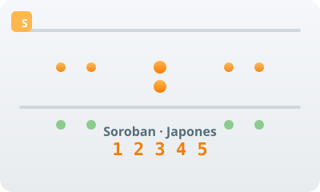
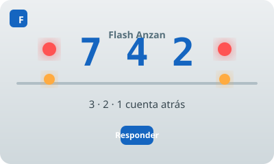
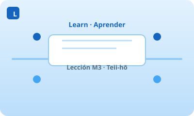
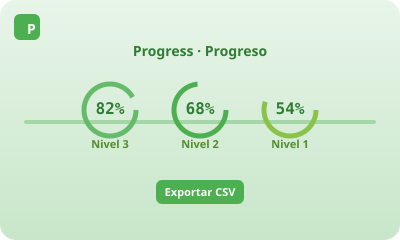

# MathMaster

[](https://github.com/wulflo/MathMaster/actions/workflows/ci.yml)
[](https://wulflo.github.io/MathMaster/)
[](LICENSE)
[](https://www.rust-lang.org/)

**English** · [Español](README.es.md)

MathMaster is a focused mental-arithmetic trainer built around the **soroban** (Japanese abacus) and *Anzan* (mental calculation). It teaches the abacus step by step, then fades the visual support away until sums, subtractions and front multiplication can be done mentally. The same Leptos UI runs as a static offline web app and inside a Tauri desktop host with native audio.

**🌐 Web app:** <https://wulflo.github.io/MathMaster/> · **📦 Source:** <https://github.com/wulflo/MathMaster>

> The horizontal-tab redesign described below is built and verified locally; the published Pages build may still show the earlier single-column release until it is republished.

## Preview

| Soroban — japonés | Flash Anzan |
|---|---|
| [**Soroban**]<br><br>Varas de 4 a 13, cinco etapas de desvanecimiento, demostrador de movimiento. | [**Flash Anzan**]<br><br>Suma o suma/resta mixta, fijación 3·2·1, reconocimiento instantáneo de respuesta. |
| Learn — aprender | Progress — progreso |
| [**Learn**]<br><br>Anatomía del soroban, digitación ortodoxa, amigos pequeños y grandes, lecciones M0–M7. | [**Progress**]<br><br>Panel de dominio, repasos espaciados, diagnósticos por regla e historial de sesiones. |

## Table of contents

- [Preview](#preview)
- [Why it is different](#why-it-is-different)
- [Application map](#application-map)
- [Architecture](#architecture)
- [Quick start](#quick-start)
- [Documentation](#documentation)
- [Licenses](#licenses)

## Why it is different

- **Pedagogy first, speed second.** Six structured chapters cover abacus anatomy, orthodox fingering, small friends (5-complements), large friends (10-complements), mixed families and the progressive fade to mental Anzan. Multiplication lessons M0–M7 and shortcuts S1–S4 include the mathematical foundation, *Teii-hō* rod positioning, a detailed procedure, common traps and an annotated example.
- **Frame-accurate timing.** Stimuli are planned in frames, never in loosely rounded milliseconds. The exposure and gap controls show their frame equivalent and the resulting terms/second in real time.
- **Instant answer recognition.** Every practice mode focuses the answer field for you and checks the value on each keystroke. A correct value is accepted immediately and, with auto advance enabled by default, the next exercise starts at once. A wrong answer reveals the expected value and offers a one-click walkthrough on the soroban.
- **A complete training ground.** Flash Anzan (sum-only or mixed sums/subtractions, with a 3·2·1 fixation countdown), Mitori Anzan exam-style columns, leveled multiplication, weakness-driven drills, spaced review, per-rule diagnostics and CSV export.
- **Material Aero.** Material 3 tokens, translucent surfaces, ten selectable accents, light/dark themes, reduced-motion and reduced-transparency support, and no full-screen flashes.

## Application map

| Tab | Subsections |
|-----|-------------|
| **Learn** | Soroban fundamentals · Front multiplication (空盘前乘法) · Mental shortcuts · 大九九 table |
| **Free soroban** | Interactive abacus (4–13 rods, five fade stages) · Movement demonstrator |
| **Train** (default) | Flash Anzan · Mitori Anzan · Leveled multiplication · Targeted training |
| **Progress** | Mastery panel · Spaced review · Rule diagnostics and session history |

The default active tab is **Train → Flash Anzan**, which keeps the UI automation harnesses (`--ui-selftest` and `--measure`) working without extra navigation.

Keyboard: `←`/`→`/`Home`/`End` move between tabs, `0`–`9` and `Backspace` edit an answer, `Enter` confirms or continues, and `Space` starts or repeats a sequence.

## Architecture

| Crate | Role |
|-------|------|
| `anzan-core` | Soroban state, valid rods/slots, `plan_add`/`plan_sub`, fading and geometry. No internal dependencies; `forbid(unsafe_code)`. |
| `anzan-engine` | Frame plans and telemetry, deterministic drills (Flash, mixed, focused, Mitori, multiplication), speed conversion, progression, sessions, reviews and pedagogic classification. |
| `anzan-content` | All visible text and all pedagogical material in validated RON dictionaries with exact es/en key parity; `forbid(unsafe_code)`. |
| `anzan-ui` | Leptos components: tabs, learning views, lab, training, answer box and progress panels. |
| `anzan-app` | Web bootstrap: locale detection, `<html lang>` and WASM mount. |
| `anzan-desktop` | Tauri 2 host: native cpal audio, disk persistence and automation harnesses. |

Dependency direction is enforced by `scripts/check-deps.sh`:

`ui → engine → core`, `content → core`, `app → ui/engine/content/core`, `desktop → engine/content`.

No visible string lives in Rust: interface copy and course content are loaded from `crates/content/content/i18n/{es,en}.ron` and `crates/content/content/multiplication/{es,en}.ron`, and the loaders reject unknown keys.

## Quick start

```bash
# Toolchain: Rust 1.99.x with the wasm32-unknown-unknown target
cargo test --workspace
./ci.sh                    # fmt, forbidden constructs, clippy -D warnings, tests,
                           # dependency rules, cargo deny and wasm32 check
./scripts/build-web.sh     # static build into dist/
cargo tauri dev            # desktop host (needs webkit2gtk and dist/)
cargo tauri build --bundles appimage,deb
```

The desktop automation modes are `cargo tauri dev -- --ui-selftest` and `cargo tauri dev -- --measure` (see `scripts/measure-desktop.sh` for a full run).

## Documentation

- [`docs/CHECKLIST-REDESENO.md`](docs/CHECKLIST-REDESENO.md) — master plan for this redesign.
- [`docs/CHECKLIST.md`](docs/CHECKLIST.md) — historical phase checklist and resume point.
- [`docs/LOG.md`](docs/LOG.md) — append-only work log.
- [`docs/DISENO.md`](docs/DISENO.md) — Material Aero design system.
- [`docs/METODO-MULTIPLICACION.md`](docs/METODO-MULTIPLICACION.md) — multiplication method.
- [`docs/DECISIONES.md`](docs/DECISIONES.md) — architecture decision records.
- [`docs/MEDICIONES.md`](docs/MEDICIONES.md) — real timing measurements and limits.
- [`docs/EMPAQUETADO.md`](docs/EMPAQUETADO.md) — Linux bundles.

## Licenses

### This project

- Source code: [AGPL-3.0-or-later](LICENSE).
- Educational content: [CC BY-SA 4.0](LICENSE-CONTENT).
- Original sounds and dictionaries: CC0 1.0 (see [`CREDITS.md`](CREDITS.md)).

### Rust dependencies

Versions are pinned in `Cargo.toml`/`Cargo.lock`; `cargo deny check` verifies the full graph.

| Crate | Version | License |
|-------|---------|---------|
| serde | 1.0.229 | MIT OR Apache-2.0 |
| ron | 0.12.3 | MIT OR Apache-2.0 |
| thiserror | 2.0.21 | MIT OR Apache-2.0 |
| leptos | 0.8.23 | MIT |
| wasm-bindgen | 0.2.130 | MIT OR Apache-2.0 |
| wasm-bindgen-futures | 0.4.80 | MIT OR Apache-2.0 |
| js-sys / web-sys | 0.3.107 | MIT OR Apache-2.0 |
| console_error_panic_hook | 0.1.7 | Apache-2.0 OR MIT |
| proptest (dev) | 1.12.0 | MIT OR Apache-2.0 |
| tauri / tauri-build | 2.12.5 / 2.7.4 | Apache-2.0 OR MIT |
| cpal | 0.18.2 | Apache-2.0 |
| rtrb | 0.4.1 | MIT OR Apache-2.0 |
| serde_json | 1.0.150 | MIT OR Apache-2.0 |

### Tools and platform components

| Component | Version used | License |
|-----------|--------------|---------|
| Rust toolchain (rustc, cargo) | 1.99.1 | MIT OR Apache-2.0 |
| wasm-bindgen CLI | 0.2.130 | MIT OR Apache-2.0 |
| Tauri CLI | 2.12.4 | Apache-2.0 OR MIT |
| cargo-deny | 0.22.0 | MIT OR Apache-2.0 |
| WebKit2GTK | 4.1 (system) | LGPL-2.1-or-later |
| GTK | 3.x (system) | LGPL-2.1-or-later |
| ALSA (desktop audio backend) | system | LGPL-2.1-or-later |
| Web Audio API | browser implementation | W3C royalty-free specification |

Transitive dependencies, including their licenses, are listed by `cargo deny list`; `deny.toml` documents the small set of unmaintained transitive crates that are currently ignored with a reason.

---

Made with ❤️ and Rust · [wulflo/MathMaster](https://github.com/wulflo/MathMaster)
